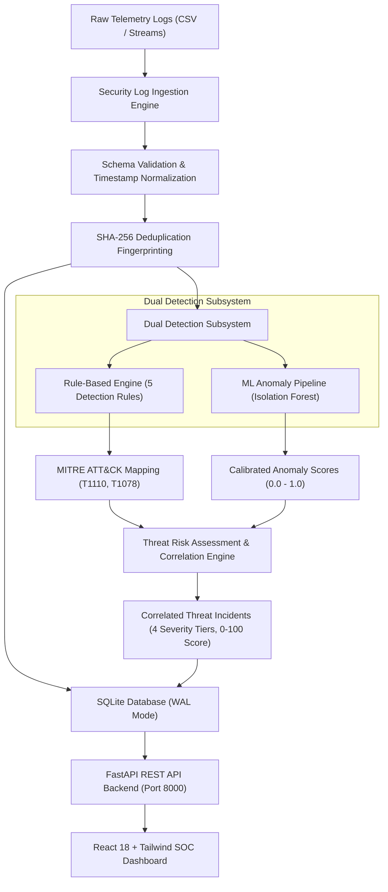

# CyberShield AI — Intelligent Cyber Threat Detection

[](https://github.com/yadavpriyanshu1655-ship-it/404-Challengers-HK26-0010)
[](#official-problem-abcs-01)
[](#technology-stack)
[](#technology-stack)
[](#running-tests)
[](SECURITY.md)

Developed by hackathon team **404 Challengers** (`HK26-0010`), **CyberShield AI** is an intelligent, explainable security operations and threat detection platform. It ingests enterprise security telemetry, isolates behavioural anomalies, classifies sophisticated cyber attacks, calculates multi-factor risk scores, and dispatches real-time security alerts to an interactive SOC analyst dashboard.

---

## Official Problem: ABCS-01

**ABCS-01 — Intelligent Cyber Threat Detection** requires building an end-to-end security telemetry intelligence system capable of detecting, analyzing, and mitigating modern cyber threats in real time.

### Core Objectives & The 5 Official Requirements

1. **AI-Based Threat Detection:** Supervised machine learning algorithms trained to detect and classify multi-stage attack patterns (e.g., brute force, credential stuffing, privilege escalation, data exfiltration, distributed reconnaissance).
2. **Anomaly Detection:** Unsupervised outlier detection (`IsolationForest`) identifying zero-day threats, unusual volume spikes, non-standard operating hours, and atypical entity behaviour without predefined signatures.
3. **Threat Risk Assessment:** Multi-factor risk calculation engine mapping incidents to a normalized 0–100 risk score, incorporating asset criticality, attack velocity, anomaly deviation, and MITRE ATT&CK taxonomy.
4. **Real-Time Security Alerts:** Instant push notification mechanism providing live alert feeds, deduplication, alert aggregation, and analyst triage lifecycle management (`Open` $\rightarrow$ `Investigating` $\rightarrow$ `Resolved` $\rightarrow$ `Dismissed`).
5. **Security Dashboard:** High-density, responsive SOC console (React + Vite + Tailwind CSS) featuring telemetry metrics, severity distributions, temporal attack trends, and interactive alert inspection drawers.

---

## Technology Stack

| Domain | Technology | Purpose |
| :--- | :--- | :--- |
| **Frontend Framework** | React 18 (Vite 5) | High-performance component architecture for SOC interface |
| **Styling & UI** | Tailwind CSS + Lucide Icons | Responsive dark-mode SOC console design system |
| **Visualizations** | Recharts (v2.15) | Interactive severity distribution and temporal activity trend charts |
| **Backend Framework** | Python + FastAPI + Uvicorn | High-concurrency async REST API and detection pipeline |
| **API Contracts** | Pydantic v2 | Strict request/response validation and interactive OpenAPI docs |
| **Data Processing** | Pandas + NumPy | Rolling-window aggregation, telemetry normalization, feature extraction |
| **Machine Learning** | Scikit-learn (Isolation Forest) | Reproducible unsupervised outlier discovery & categorical preprocessing |
| **Risk & Correlation** | Python Risk Engine | Transparent multi-factor risk scoring (0-100) & incident correlation |
| **Persistence** | SQLite (WAL Mode) & Joblib | Lightweight relational storage & serialized ML artifact persistence |
| **Testing & Quality** | Pytest + Starlette TestClient | Comprehensive unit, integration, API contract, and security testing |

---

## System Architecture & Data Flow



---

## React Security Dashboard Architecture

CyberShield AI features a cybersecurity operations dashboard (`frontend/`) built with React, Vite, Tailwind CSS, Recharts, and Lucide icons.

### Key Components & Capabilities
- **Overview Metrics Grid:** 5 operational cards tracking processed telemetry records, correlated threats, open triage items, high/critical priority counts, and machine learning anomaly outliers.
- **Threat Severity Distribution:** Recharts Donut/Pie chart displaying proportions across Critical, High, Medium, and Low severity tiers with interactive hover tooltips.
- **Threat Activity Trends:** Recharts AreaChart with gradient shading rendering 7-day telemetry velocity.
- **Threat Alert Table:** Interactive tabular layout with real-time text search, multi-criteria severity and status dropdown filters, and pagination controls.
- **Incident Detail Slide-over Drawer:** Granular inspection view with MITRE ATT&CK technique tags, composite risk score breakdown, evidentiary confidence, transparent supporting evidence bullet points, prescriptive safe defensive recommendations, and status triage controls (`Open`, `Investigating`, `Resolved`, `Dismissed`).
- **Telemetry Logs Explorer:** Raw normalized event viewer with status badges, payload size, resource path, and JSON modal inspector.
- **Detection Coverage Matrix:** Interactive matrix detailing all 5 deterministic rules, behavioral baseline parameters, and Isolation Forest ML pipeline.
- **Transparent Synthetic Benchmark Advisory:** Prominent banner clearly designating synthetic benchmark telemetry for ABCS-01 without presenting sample metrics as unverified production findings.

---

## REST API Documentation & Endpoints

CyberShield AI provides a full-featured REST API conforming to OpenAPI specifications. When the server is running, interactive documentation is accessible at `http://127.0.0.1:8000/docs` (Swagger UI) and `http://127.0.0.1:8000/redoc` (ReDoc).

| HTTP Method | Endpoint | Description | Request / Query Parameters | Response Schema |
| :--- | :--- | :--- | :--- | :--- |
| `GET` | `/api/health` | Health check & system diagnostics | None | `HealthResponse` |
| `POST` | `/api/logs/upload` | Ingest security telemetry CSV file | `file: UploadFile` (Multipart, $\le 10$ MB) | `UploadLogsResponse` |
| `POST` | `/api/detection/run` | Trigger on-demand detection over persisted events | None | `DetectionRunResponse` |
| `GET` | `/api/events` | List paginated security events with filters | `limit`, `offset`, `username`, `source_ip`, `event_type`, `status`, `search` | `EventListResponse` |
| `GET` | `/api/events/{id}` | Retrieve specific security event details | `id: int` (Path parameter) | `SecurityEventSchema` |
| `GET` | `/api/alerts` | List paginated alerts & correlated incidents | `limit`, `offset`, `severity`, `status`, `entity`, `search` | `AlertListResponse` |
| `GET` | `/api/alerts/{id}` | Retrieve granular incident details & evidence | `id: int` (Path parameter) | `AlertResponse` |
| `PATCH` | `/api/alerts/{id}` | Update alert triage state | `payload: {"status": "Resolved"}` | `{"updated": true, "id": ..., "status": ...}` |
| `GET` | `/api/dashboard/stats` | Executive summary metrics & time trends | None | `DashboardStatsResponse` |
| `POST` | `/api/demo/sample` | Load demo telemetry and run pipeline | None | `{"message": ..., "valid_rows": ..., ...}` |
| `POST` | `/api/demo/reset` | Clear events, alerts, and anomalies | None | `{"reset": true, "message": ...}` |

---

## Threat Risk Assessment & Incident Correlation

CyberShield AI features a transparent, multi-factor risk engine (`backend/risk_assessment.py`) that correlates rule-based detections, ML anomalies, and contextual telemetry into unified, prioritized `CorrelatedIncident` entities.

### 4-Tier Severity Model

| Severity Tier | Composite Risk Score Band | Description | Typical Response SLA |
| :--- | :---: | :--- | :---: |
| **Critical** | **85 – 100** | High-confidence multi-stage attack or confirmed credential compromise (e.g., successful login following repeated brute-force failures targeting administrative accounts). | **Immediate (< 15 min)** |
| **High** | **65 – 84** | Serious attack activity (e.g., active brute-forcing, volumetric spray bursts, unprecedented external subnet shifts). | **< 1 hour** |
| **Medium** | **40 – 64** | Noticeable deviations from baseline behavior (e.g., unusual login hours, uncorroborated statistical anomalies). | **< 4 hours** |
| **Low** | **0 – 39** | Informational policy findings or minor single-point anomalies with low confidence. | **Next business day** |

### Transparent Additive Risk Factor Model
Every incident calculates a deterministic score in $[0, 100]$ using documented component adjustments:
- **Rule Evidence Baseline:** Critical rule $= +80$, High rule $= +65$, Medium rule $= +40$, Low rule $= +20$.
- **ML Anomaly Contribution:** $+5$ to $+15$ depending on Isolation Forest peak anomaly score.
- **Privileged Identity Target:** $+10$ when targeting accounts like `root`, `admin`, or sensitive system services.
- **External Network Ingress:** $+5$ when origin IP is from outside internal RFC 1918 private subnets.
- **Multi-Rule Synergy:** $+10$ when multiple distinct attack tactics match the same entity.
- **Velocity Burst:** $+5$ when $\ge 5$ correlated events occur within the correlation window.

### Key Governance Guarantees
1. **Strict Separation of Dimensions:** `severity` (impact tier), `confidence` ($0.0 \dots 1.0$), `anomaly_score` ($0.0 \dots 1.0$), and `composite_risk_score` ($0 \dots 100$) are calculated and reported independently.
2. **Evidence-Based Correlation:** Only groups events that share a common entity (`username` or `source_ip`) within a configurable sliding window ($\le 15.0$ minutes). **Unrelated entities and distant timestamps are never co-mingled.**
3. **Non-Confirmation Constraint:** **An incident is NEVER marked confirmed based solely on an anomaly score.** Anomaly-only clusters remain `is_confirmed = False`, `confirmation_status = "Unconfirmed Anomaly"`, with confidence capped at $\le 0.45$.
4. **Safe Defensive Recommendations:** All findings provide prescriptive, non-destructive SOC guidance (e.g., out-of-band verification, session token revocation, temporary ingress rate-limiting).

---

## Machine-Learning Anomaly Detection (`IsolationForest`)

CyberShield AI integrates an unsupervised anomaly detection pipeline (`backend/ml/anomaly.py`) powered by Scikit-learn's `IsolationForest`:

- **Leakage-Free Preprocessing:** A `ColumnTransformer` combines `StandardScaler` for numeric dimensions and `OneHotEncoder(handle_unknown='ignore')` for categorical types, fit strictly on training data (`training_telemetry.csv`).
- **Feature Extraction:** 8 domain features extracted:
  - Cyclical Hour of Day ($\sin(2\pi h/24), \cos(2\pi h/24)$)
  - Day of Week (0–6)
  - Log-transformed Payload Size ($\ln(1 + \text{bytes})$)
  - Failure Flag ($0/1$)
  - External IP Indicator (RFC 1918 private subnet check)
  - Privileged Account Flag (`admin`, `root`, `service`)
  - Categorical Event Type Encoding (`login`, `file_access`, `sudo_command`, `api_request`)
- **Hyperparameters:** `n_estimators=100`, `contamination=0.08`, `random_state=42`, `n_jobs=-1`.
- **Model Persistence:** Serialized safely via `joblib` to [`backend/models/isolation_forest.joblib`](file:///home/priyanshu/.gemini/antigravity/worktrees/CyberShield/architecture_proposal_threat_detection/backend/models/isolation_forest.joblib).
- **Actual Held-Out Evaluation Metrics:**
  - **Training Sample Count:** 40 events
  - **Evaluation Sample Count:** 20 events (`held_out_telemetry.csv`)
  - **Contamination Rate:** 0.08 (8%)
  - **Detected Anomalies:** 4 events ($20\%$)
  - **Mean Anomaly Score:** 0.4377
- **Mandatory Governance Disclaimer:** Every anomaly finding carries an explicit advisory:
  > *"Statistical anomaly indicator only; does not necessarily indicate malicious intent."*

---

## Datasets & Synthetic-Data Disclaimer

CyberShield AI provides four clearly labeled CSV datasets located in `backend/data/`:

| Dataset File | Event Count | Purpose & Description |
| :--- | :---: | :--- |
| `sample_logs.csv` | 11 | SOC demonstration dataset showcasing brute-force password guessing, credential compromise, and benign authentications. |
| `synthetic_logs.csv` | 25 | Labeled benchmark dataset covering all 5 attack scenarios, baseline authentications, off-hour logins, and volumetric bursts. |
| `training_telemetry.csv` | 40 | Normal baseline enterprise operations data used strictly for fitting ML scalers, encoders, and isolation trees. |
| `held_out_telemetry.csv` | 20 | Unseen test telemetry used for evaluating model anomaly detection rates and decision functions without leakage. |

> [!NOTE]
> **Synthetic Data Disclaimer:** All security telemetry and user identities in these datasets are synthetically generated for challenge **ABCS-01**. They are clearly labeled as benchmark data and do not represent actual customer or corporate systems.

---

## Rule-Based Threat Detection Engine

| Rule Name | Severity | Default Threshold | Description | MITRE Technique |
| :--- | :---: | :--- | :--- | :--- |
| **Repeated Failed Logins** | **High** | $\ge 5$ failures in $\le 10$ mins | Flags sustained brute-force authentications. | `T1110.001` (Password Guessing) |
| **Success Following Repeated Failures** | **Critical** | $\ge 3$ failures followed by success in $\le 10$ mins | Identifies successful logins immediately preceded by repeated failures (account compromise). | `T1110.001` (Password Guessing) |
| **Unusually High Login Frequency** | **High** | $\ge 10$ attempts in $\le 2$ mins | Flags volumetric bursts exceeding human interaction capability. | `T1110.003` (Password Spraying) |
| **Unusual Login Hours** | **Medium / High** | $> 2$h outside baseline hours | Evaluates user logins against an established behavioral baseline ($\ge 5$ prior logins). | `T1078` (Valid Accounts) |
| **Suspicious Login Behavioral Shift** | **High** | Unprecedented network subnet | Identifies authentications from unfamiliar subnets for users with baseline history ($\ge 8$ logins). | `T1078.003` (Local Accounts) |

---

## Project Structure

```
CyberShield/
├── .gitignore                    # Exclusions for environments, bytecode, logs, builds
├── README.md                     # Comprehensive project documentation
├── PHASE_STATUS.md               # Implementation phases and milestone status
├── DEMO_AND_PRESENTATION.md      # Hackathon submission handbook, demo guide & speaking script
├── SECURITY.md                   # Defensive security model, threat review & operational controls
├── backend/
│   ├── detection.py              # Configurable rule-based threat detection engine
│   ├── ingestion.py              # Standalone Security Log Ingestion engine
│   ├── main.py                   # FastAPI REST application entrypoint
│   ├── requirements.txt          # Backend dependencies
│   ├── risk_assessment.py        # Threat risk assessment & incident correlation engine
│   ├── sample_logs.csv           # Baseline synthetic security telemetry
│   ├── data/                     # Ingestion datasets and training data
│   │   ├── .gitkeep
│   │   ├── sample_logs.csv
│   │   ├── synthetic_logs.csv    # Labeled synthetic security telemetry dataset
│   │   ├── training_telemetry.csv# Baseline normal telemetry for ML training
│   │   └── held_out_telemetry.csv# Held-out evaluation telemetry
│   ├── db/                       # Persistence subsystem
│   │   ├── __init__.py
│   │   └── database.py           # SQLite connection, WAL mode, migrations, queries
│   ├── ml/                       # Machine Learning subsystem
│   │   ├── __init__.py
│   │   ├── anomaly.py            # Isolation Forest anomaly detection pipeline
│   │   └── features.py           # Feature extraction & ColumnTransformer preprocessing
│   ├── models/                   # Entity schemas and ML model artifacts
│   │   ├── __init__.py
│   │   ├── alert.py              # ThreatAlert model
│   │   ├── anomaly.py            # AnomalyFinding & ModelEvaluationReport models
│   │   ├── event.py              # SecurityEvent, IngestionResult & RejectedRow models
│   │   ├── isolation_forest.joblib # Persisted trained Isolation Forest model
│   │   └── risk.py               # CorrelatedIncident, RiskFactor & RiskSeverity models
│   ├── schemas/                  # Pydantic v2 REST API schemas
│   │   ├── __init__.py
│   │   └── api.py                # Health, Event, Alert, Dashboard & Error schemas
│   └── tests/                    # Pytest test suite (109 passing tests)
│       ├── __init__.py
│       ├── test_anomaly.py       # 12 tests: ML pipeline, leakage, persistence, reproducibility
│       ├── test_api.py           # 18 tests: FastAPI REST endpoints, uploads, filters, CORS
│       ├── test_detection.py     # 23 tests: rules, boundaries, baselines, deduplication
│       ├── test_e2e_integration.py # 5 tests: full-stack upload to alert drawer lifecycle
│       ├── test_ingestion.py     # 20 tests: ingestion, schemas, validation, pandas
│       ├── test_mvp.py           # 5 tests: MVP regression tests
│       ├── test_risk_assessment.py # 10 tests: risk scoring, severity bands, correlation
│       └── test_security_qa.py   # 16 tests: SQLi resilience, XSS inertness, traceback masking
└── frontend/                     # React + Vite + Tailwind dashboard
    ├── index.html                # Vite HTML mount
    ├── package.json              # Node dependencies & scripts
    ├── postcss.config.js         # PostCSS plugins
    ├── tailwind.config.js        # Dark theme cyber tokens
    ├── vite.config.js            # Vite build & proxy config
    └── src/
        ├── App.jsx               # Main dashboard layout
        ├── index.css             # Tailwind base & custom scrollbars
        ├── main.jsx              # React root mount
        ├── components/
        │   ├── alerts/           # AlertTable, AlertDetailDrawer
        │   ├── common/           # Header, Sidebar, Badge, Skeleton, EmptyState, Banner
        │   ├── dashboard/        # MetricsGrid, SeverityChart, TrendChart, Coverage
        │   └── events/           # EventTable, EventDetailModal
        ├── constants/            # Severity, status & detection configs
        ├── data/                 # Labeled synthetic benchmark datasets
        └── services/             # REST API service client with fallback
```

---

## Planned Features Roadmap

- [x] **Phase 00:** Architecture proposal, environment baseline inspection, and dependency mapping.
- [x] **Phase 01:** Foundation establishment, approved directory structure, Git configuration, and documentation.
- [x] **Phase 02:** Standalone Security Log Ingestion module, event schema specification, synthetic telemetry, and Pytest validation.
- [x] **Phase 03:** Explainable rule-based threat detection engine, configurable thresholds, behavioral baseline profiles, and 48 passing tests.
- [x] **Phase 04:** Unsupervised machine-learning anomaly detection (`IsolationForest`), feature extraction, safe model persistence, and 60 passing tests.
- [x] **Phase 05:** Composite multi-factor threat risk assessment engine (0-100 scale), severity classification, incident correlation, and 70 passing tests.
- [x] **Phase 06:** FastAPI REST backend, Pydantic schemas, SQLite persistence, filtered queries, CORS, and 88 passing tests.
- [x] **Phase 07:** React + Vite + Tailwind CSS SOC dashboard with threat activity charts, alert inspection, and triage controls.
- [x] **Phase 08:** Full-stack integration, live log upload station, and end-to-end demo verification (93 passing tests).
- [x] **Phase 09:** Security review and quality assurance (input validation, SQLi/XSS resilience, error masking, false-positive evaluation, [SECURITY.md](SECURITY.md), 109 passing tests).
- [x] **Phase 10:** Hackathon submission and demo preparation (reproducible demo scenario, 3–5 min speaking script, presentation deck outline, final acceptance checklist, [DEMO_AND_PRESENTATION.md](DEMO_AND_PRESENTATION.md)).

---

## Full-Stack Integration & SOC Workflow (Phase 08 & 09)

CyberShield AI connects the React operations dashboard directly with the FastAPI intelligence backend:

### Complete 8-Step SOC Workflow
1. **Upload Telemetry:** Analysts drop or select a CSV log file via the **Upload CSV** modal (or click **Load Benchmark Sample**).
2. **Validate & Ingest:** The backend validates mandatory fields (`timestamp`, `source_ip`, `username`, `event_type`, `status`), normalizes ISO timestamps, and detects duplicates using SHA-256 fingerprinting.
3. **Detection Execution:** Ingested events trigger the 5 deterministic detection rules and the Scikit-learn `IsolationForest` anomaly scoring pipeline.
4. **Risk Correlation:** Findings are evaluated through the 4-tier risk matrix (Low, Medium, High, Critical) with transparent additive evidence scores and MITRE ATT&CK taxonomy tags.
5. **Persistent Storage:** Accepted events, calculated anomalies, and deduplicated threat alerts are committed to SQLite (`cybershield.db`).
6. **Live Dashboard Sync:** Overview metrics, severity distribution donut charts, and temporal activity curves automatically update.
7. **Incident Inspection:** Analysts open any alert in the slide-over drawer to inspect supporting evidence, observed values vs. thresholds, and prescriptive safe defensive actions.
8. **Triage Lifecycle:** Analysts search across entities/IPs, filter by severity, and transition alert triage status (`Open` $\rightarrow$ `Investigating` $\rightarrow$ `Resolved` $\rightarrow$ `Dismissed`).

---

## Development Commands

### Prerequisites
- Python $\ge$ 3.10 (Tested on Python 3.14)
- Node.js $\ge$ 18.0 (Tested on Node.js v24.21.0, npm 12.0.2)

### 1. Backend Setup & Execution
```bash
# Optional: Create and activate virtual environment
python3 -m venv .venv
source .venv/bin/activate

# Install backend dependencies
pip install -r backend/requirements.txt

# Start the FastAPI development server
uvicorn backend.main:app --host 127.0.0.1 --port 8000 --reload
```

### 2. Running Backend Tests
```bash
# Run full test suite across all 109 tests
pytest backend/tests

# Run specifically the Phase 09 Security & QA test suite
pytest backend/tests/test_security_qa.py -v

# Run specifically the Phase 08 End-to-End integration tests
pytest backend/tests/test_e2e_integration.py -v

# Run specifically the REST API tests
pytest backend/tests/test_api.py -v

# Run specifically the risk assessment & correlation tests
pytest backend/tests/test_risk_assessment.py -v

# Run specifically the ML anomaly detection tests
pytest backend/tests/test_anomaly.py -v

# Run specifically the rule-based detection tests
pytest backend/tests/test_detection.py -v

# Run specifically the log ingestion tests
pytest backend/tests/test_ingestion.py -v

# Run legacy unittest regression suite
python3 -m unittest backend/tests/test_mvp.py
```

### 3. Frontend Development & Build
```bash
# Navigate to frontend directory
cd frontend

# Install frontend dependencies (if not already installed)
npm install

# Start Vite development server
npm run dev

# Build production bundle
npm run build
```

### 4. Deploy to Render

The repository includes a Render Blueprint (`render.yaml`) that deploys the
FastAPI backend and Vite dashboard as separate services:

1. Push this repository to GitHub.
2. In Render, select **New + → Blueprint** and connect this repository.
3. Review the two services and select **Apply**.
4. Open the `cybershield-dashboard` service URL when both deployments finish.

The Blueprint configures the dashboard's API URL and the backend's CORS origin
automatically. Free Render web services use an ephemeral filesystem, so demo
SQLite data can be lost when the backend restarts or redeploys.

---

## Hackathon Submission & Demonstration Guide (Phase 10)

For evaluators and judges of **Challenge ABCS-01**, all submission and presentation deliverables are compiled in the dedicated handbook:

👉 **[DEMO_AND_PRESENTATION.md](DEMO_AND_PRESENTATION.md)**

### Key Submission Deliverables Included
1. **Reproducible Demo Scenario (7 Steps):** Complete walkthrough from cold startup (`uvicorn backend.main:app`), log ingestion, brute-force alert inspection, anomaly triage, to SOC lifecycle resolution.
2. **3–5 Minute Speaking Script:** Time-stamped, cue-by-cue script tailored for live pitch and technical demo evaluations.
3. **7-Slide Presentation Deck Outline:** Structured slides covering Problem, Architecture, Dual Detection, Risk Correlation, Verification, Impact, and Roadmap.
4. **Final Acceptance Checklist:** Line-by-line verification against all 5 official ABCS-01 requirements (AI Detection, Anomaly Detection, Risk Assessment, Real-Time Alerts, SOC Dashboard).

---

## Known Limitations & Operational Boundaries

To maintain technical integrity and avoid unsupported claims, the prototype's operational boundaries are documented below:

1. **Synthetic Telemetry Baseline:**
   - The system is evaluated on synthetic security logs (`backend/data/`). It has not been benchmarked against live enterprise APT traffic or high-volume multi-gigabit perimeter logs. Real-world deployment requires domain-specific re-training.
2. **Unsupervised Anomaly Non-Confirmation:**
   - As an unsupervised algorithm, `IsolationForest` identifies statistical feature outliers, not confirmed malicious behavior. CyberShield AI strictly enforces the non-confirmation constraint: anomalies without rule-based attack signatures are capped at Medium severity and marked unconfirmed.
3. **Single-Node Ingestion & File Ceiling:**
   - Ingestion is optimized for batch CSV uploads up to **10 MB** (enforced by FastAPI middleware). High-velocity streaming ingestion requires distributed brokers (e.g., Apache Kafka).
4. **SQLite Storage Backend:**
   - The database engine is SQLite with Write-Ahead Logging (WAL). While suitable for prototype evaluations and moderate SOC workloads, multi-node enterprise deployments require PostgreSQL or a dedicated time-series database.
5. **No Destructive Active Defense:**
   - Prescriptive recommendations in alerts are defensive and advisory (e.g., identity verification, credential resets, edge rate-limiting). The prototype intentionally does not execute destructive automated firewall changes or host shutdowns.

---

## Future Improvements & Strategic Roadmap

- **Streaming Telemetry Pipeline:** Native connectors for Apache Kafka, AWS Kinesis, and syslog RFC-5424 streams for sub-second ingestion.
- **Bi-Directional SIEM Integrations:** Webhook forwarders to Splunk, Microsoft Sentinel, and Elastic Security.
- **Generative AI SOC Assistant:** Secure local LLM copilot for natural language investigation queries and automated incident briefing generation.
- **Graph-Based Attack Path Correlation:** Graph database integration (Neo4j) to map multi-stage lateral movement and privilege escalation chains across network subnets.
- **Automated Baseline Profiling:** Automated rolling baseline calculation for user behavior analytics (UBA) over 30-day sliding windows.

---

## Team & Contribution

- **Team:** 404 Challengers (`HK26-0010`)
- **Hackathon:** All-India Cybersecurity Hackathon 2026
- **Lead Contact:** `yadavpriyanshu1655@gmail.com`
